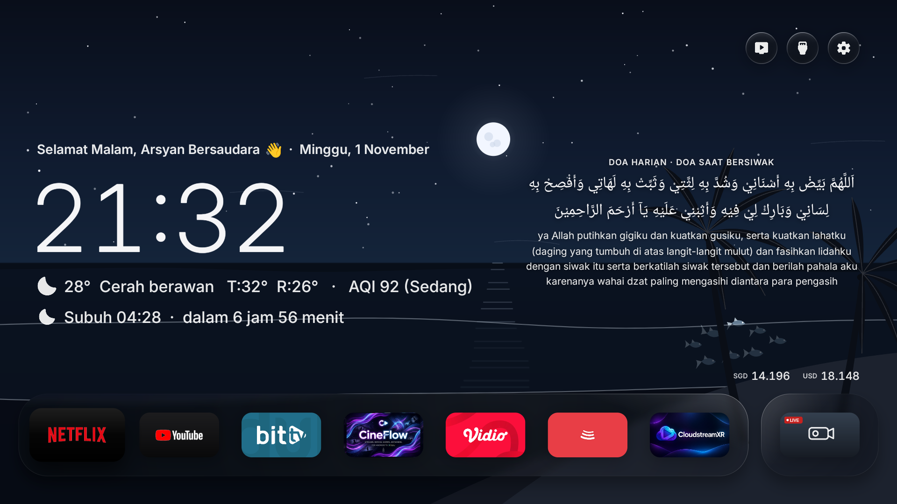
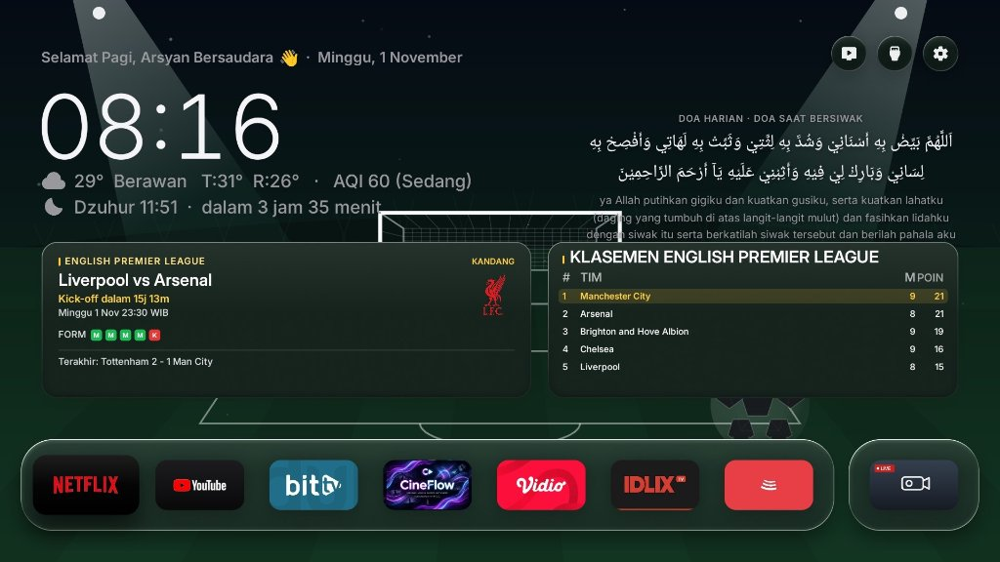
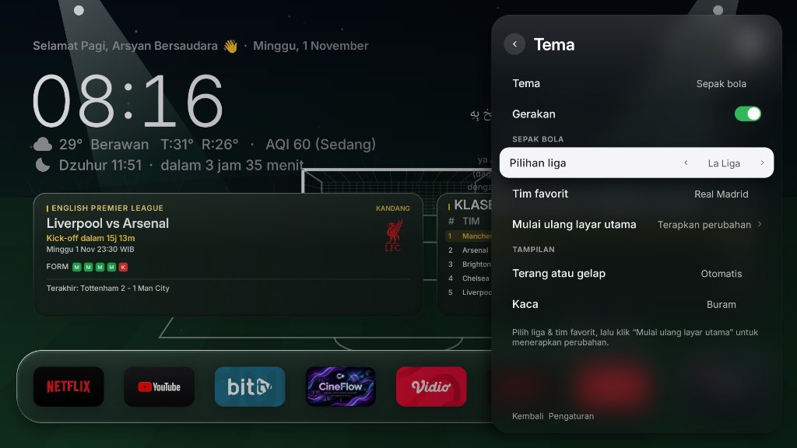

# Arsyan TV Launcher v2.8

[](https://github.com/ssemyy-sds/arsyan-tv-launcher)

A clean, modern, and aesthetic Android TV launcher inspired by Nothing OS and Apple TV design philosophies. Built natively for Android TV and Google TV devices with fluid glassmorphism, clean typography, live dynamic weather, real-time Air Quality Index (AQI), currency exchange rates, dynamic daily Islamic prayers/ayahs, **Live Football / Soccer Theme (Jadwal Pertandingan & Klasemen Liga)**, **Now Playing music overlay (BitChord / Spotify / YouTube Music)**, **seamless Over-The-Air (OTA) updates**, and automatic Adzan prayer time notifications. Preconfigured with Kota Batam as default, with full support for any city across Indonesia and worldwide.

---

## 📺 Showcase

### 1. Dynamic Ocean & Coast Vector Wallpaper (Tema Pantai & Laut Lepas)
Pengganti total live wallpaper pegunungan dengan tema pesisir pantai vektor murni (*Android Canvas*). Menampilkan cakrawala laut lepas, 3 lapisan ombak bergulung lembut (60 FPS), pohon kelapa yang tertambat tenang ditiup angin pantai, serta kawanan 8 ekor ikan vektor interaktif yang berenang merespons tombol remote D-Pad TV. Posisi Matahari dan Bulan terbit dan terbenam secara presisi ke dalam garis cakrawala laut mengikuti waktu jam lokal nyata dengan zona bebas tabrakan teks.



---

### 2. Minimalist Home Screen with Now Playing Widget
Clean typography layout for the clock, real-time weather, AQI index, prayer countdown, and daily prayers (Doa Harian). When music is playing from **BitChord** or other media players, a sleek frosted-glass **Now Playing card** appears seamlessly above the currency line with album art, track details, progress bar, and play/pause status.


---

### 3. Live Soccer / Sepak Bola Theme & Match Widget
Dukungan wallpaper tema sepak bola dengan latar lapangan bertekstur rumput hidup dan pencahayaan lampu stadion (*stadium floodlights*). Menampilkan kartu pertandingan terkini untuk tim favorit lengkap dengan hitung mundur kick-off, logo klub, status kandang/tandang, form laga terakhir, serta tabel klasemen top liga secara langsung.



---

### 4. Pengaturan Pilihan Liga & Tim Favorit
Pilihan tema wallpaper Sepak Bola yang fleksibel langsung dari menu Pengaturan TV. Bebas memilih liga top dunia (Premier League, La Liga, Serie A, Bundesliga, Liga 1 Indonesia, UEFA Champions League) beserta klub favorit Anda hanya dengan tombol remote TV.



---

### 5. Centered Adzan Notification (~50% Screen)
An elegant, frosted smoked-glass modal (50% width) displayed in the center of the screen when prayer time arrives, accompanied by full Adzan audio that can be silenced immediately with any remote button.


---

### 6. Widget & Sound Settings
Easily toggle Adzan sound on or off directly through the TV settings or within the drawer widget area.


---

## ✨ Features

- **Live Wallpaper "Ocean & Coast" & Siklus Astronomis Dinamis (Pure Canvas 60 FPS)**:
  - **Murni Vektor Programatik**: Seluruh elemen visual (langit, laut lepas, bintang malam, pohon kelapa, ombak, hujan, ikan) digambar murni menggunakan metode Canvas Android (`Path`, `Paint`, `LinearGradient`, `RadialGradient`) tanpa aset gambar PNG/JPG eksternal, menghasilkan performa ultra-ringan 60 FPS stabil tanpa membebani RAM/CPU TV.
  - **Siklus 24 Jam Matahari & Bulan (Real-Time Astronomical Trajectory)**:
    - Posisi benda langit **tidak diam/statis**, melainkan bergerak melengkung naik dan turun secara matematis (`Math.sin(prog * Math.PI)`) mengikuti waktu jam lokal TV.
    - **Siklus Siang (Matahari: 05:00 - 19:12)**: Terbit di cakrawala laut saat fajar (05:00), mencapai titik zenit langit pada tengah hari (12:00), dan tenggelam ke batas laut saat senja (19:12) memancarkan jalur kilau keemasan (*golden reflection corridor*).
    - **Siklus Malam (Bulan: 19:12 - 05:00)**: Terbit saat awal malam (19:12), mencapai puncak langit pada tengah malam (00:06), dan tenggelam menjelang subuh (05:00) memancarkan jalur pantulan perak bercahaya ke permukaan laut.
    - **Zona Aman Bebas Tabrakan Teks (Text Anti-Overlap Safe Zone)**: Garis edar horizontal benda langit dikunci secara astronomis pada area tengah dan tengah-kanan langit (X = 50% sampai 70% lebar layar). Area kiri (X < 46%) yang memuat teks ucapan, tanggal hari, jam besar, dan informasi cuaca/sholat selalu bebas dari objek langit dan memiliki kontras gelap yang jernih.
  - **4 Fase Warna Langit & Laut Dinamis**:
    - **Fajar / Sunrise (05:00 - 07:00)**: Gradasi langit merah muda lembut dan pantulan pagi di air laut.
    - **Siang / Daylight (07:00 - 16:00)**: Langit biru toska cerah dengan laut biru jernih tropis.
    - **Senja / Golden Sunset (16:00 - 19:12)**: Gradasi langit amber, oranye hangat, dan ungu senja.
    - **Malam / Starry Night (19:12 - 05:00)**: Langit biru malam berbintang (*72 vector stars*) dengan bulan kawah bercahaya.
  - **Overlay Cuaca Hujan & Badai (Weather Reactive)**: Warna langit dan laut otomatis terdesaturasi menjadi abu-abu kebiruan saat cuaca hujan, ombak beriak lebih kencang (*choppy waves*), disertai partikel hujan kristal luminous 2 lapis (*dual-layer depth*).
  - **Kawanan Ikan Interaktif (School of Fish dengan Fisika 3D Yaw)**:
    - 8 ekor ikan vektor berenang anggun di kedalaman laut dengan animasi kibasan ekor alami (*harmonic tail wagging*).
    - **Respons D-Pad Remote TV**: Ketika tombol Panah Kiri/Kanan/Atas/Bawah ditekan, kawanan ikan berbelok mengikuti arah navigasi.
    - **3D Perspective Yaw Turn**: Saat berbalik arah berlawanan, ikan tidak berputar kaku seperti mobil putar balik, melainkan melakukan putaran lateral 3D (lebar tubuh menyempit dan membalik halus) dengan reaksi berantai (*cascading delay*) dari ikan pemimpin ke pengikut.
- **Fitur Donasi "Traktir Kopi" (Support Developer)**:
  - Tombol khusus di menu **Pengaturan -> Tentang** (*Settings -> About*) tepat di bawah tombol OTA.
  - Menampilkan popup dialog modal elegan berisi QR code statis dan pesan terima kasih hangat dari developer untuk traktir kopi dengan dukungan navigasi remote TV yang mudah ditutup.
- **Exclusive Focus on Android TV**:
  - Engineered natively for Android TV & Google TV (API 28+ / Android 9 to Android 14+).
  - Lightweight custom drawing pipeline using native Android `Canvas` without heavy WebView or hybrid framework overhead (runs at smooth 60 fps).
- **Tema Sepak Bola Interaktif (Live Football Matches & Standings)**:
  - Wallpaper dinamis bertema lapangan hijau dengan efek pencahayaan stadion (*stadium floodlights*), gawang, dan visual bola animasi.
  - **Kartu Pertandingan Klub Favorit**: Menampilkan jadwal kick-off mendatang (dengan countdown waktu nyata), venue (Kandang/Tandang), lambang klub, dan riwayat 5 pertandingan terakhir (*form guide*).
  - **Klasemen Liga Terkini**: Tabel klasemen top 5 liga yang diperbarui secara otomatis dari live football API.
  - **Mendukung Banyak Liga Populer**: English Premier League, La Liga Spanyol, Serie A Italia, Bundesliga Jerman, BRI Liga 1 Indonesia, dan UEFA Champions League yang dapat diganti sewaktu-waktu melalui menu Pengaturan.
- **Now Playing Music Widget (BitChord & Universal Media)**:
  - Automatically captures active playback metadata from **BitChord** (`com.music.bitchord.tv`), Spotify, YouTube Music, and any Android media app via native `MediaSession`.
  - Displays high-resolution rounded album cover art, song title, artist, progress line, and live play/pause indicator.
  - Positioned symmetrically on the right side above currency rates.
  - **Smart Visibility**: Automatically appears when music is playing or paused, and cleanly auto-hides when music stops to keep the home screen minimalist.
- **Over-The-Air (OTA) Updates via GitHub Releases**:
  - Direct in-app update mechanism powered by GitHub Releases API (`ssemyy-sds/arsyan-tv-launcher`).
  - Automatic background update checks with ambient notification banners when new versions are available.
  - Manual check & install directly from **Settings → About (Pembaruan Sistem / OTA)**.
  - Features real-time download progress and seamless installation without requiring a computer or ADB connection for future updates.
- **Dynamic Daily Prayer & Ayah (Doa Harian) from GitHub Raw**:
  - Expanded to **71 authentic daily prayers and Quranic ayahs** sourced dynamically from GitHub Raw CDN (`iherbs/quran-json`).
  - **Offline-First Architecture**: Caches prayers locally to ensure the home screen always loads instantly (0ms latency) even without an active internet connection.
  - **Accurate Local Time Rotation**: Automatically switches to the next prayer at 00:00 midnight local TV time (`Calendar.DAY_OF_YEAR`), eliminating UTC timezone offset delays.
- **Air Quality Index (AQI) - Batam Default & Nationwide / Worldwide**:
  - Live Air Quality data integration via Open-Meteo Air Quality API.
  - Displays US AQI values and qualitative categories (`Baik`, `Sedang`, `Sensitif`, `Tidak Sehat`, dll.) directly alongside the weather line.
  - Automatically queries the coordinates of your chosen city.
- **Prayer Times & Adzan (Batam Default, Customizable to Any City)**:
  - Automatically calculates the five daily prayer times (Subuh, Dzuhur, Ashar, Maghrib, Isya) using accurate astronomical solar positioning following Kemenag RI standards (Subuh 20°, Isya 18°, Syafi'i Asr, +2-3 min ihtiyat).
  - Preconfigured for Kota Batam (`1.1301° N, 104.0529° E`), but fully supports any city across Indonesia (Jakarta, Surabaya, Bandung, Medan, Makassar, Semarang, dll.) or worldwide by setting your city in **Settings → Home Settings → City**.
  - Next prayer countdown displayed directly on the home screen.
  - Background alarm scheduling (`AlarmManager.RTC_WAKEUP`) ensures timely alerts even if the launcher is in the background or sleeping.
  - **Smart Audio Focus Management**: Automatically pauses background media apps (YouTube, Spotify, video players) during the Adzan call, and seamlessly resumes playback once dismissed.
  - **Floating Banner Overlay**: Powered by a dedicated foreground service (`AdzanService`) to display a sleek frosted-glass alert banner on top of other running apps (like YouTube) without stealing remote control focus.
  - Full Adzan audio playback with one-click silence using any remote control key.
- **Weather & Exchange Rates**:
  - Open-Meteo integration for accurate temperature, conditions, and daily high/low.
  - Real-time SGD and USD currency exchange rates.
- **Clean Typography UI**:
  - Restores the minimalist typographic aesthetic without frosted card boxes obscuring the wallpaper.
- **Smooth Animations & Hardware Efficiency**:
  - Highly optimized for low-end to high-end Android TV boxes and Smart TVs (ZTE, Mi Box, TCL, Sony, etc.).

---

## 🌍 City & Regional Customization

Secara default, Arsyan TV terkonfigurasi awal untuk **Kota Batam**. Namun, launcher ini sepenuhnya mendukung **seluruh kota di Indonesia maupun mancanegara**:

1. Buka **Settings** (ikon gerigi di drawer aplikasi).
2. Masuk ke menu **Home Settings → City**.
3. Ketik nama kota Anda (contoh: `Jakarta`, `Surabaya`, `Bandung`, `Medan`, `Makassar`, `Semarang`, dll.).
4. Pilih kota dari hasil pencarian.
5. **Jadwal Sholat & Adzan, Prakiraan Cuaca, dan Indeks Kualitas Udara (AQI)** akan langsung terkalibrasi otomatis sesuai koordinat presisi kota yang dipilih.

---

## 🛠️ Building & Installing

### Prerequisites
- JDK 17+ or JDK 21+ (compatible with modern JDKs, including JDK 26)
- Android SDK (`build-tools 35.0.0` or `34.0.0`, `platforms/android-34`)
- ADB tools for TV connection

### Build APK
Run the build script:
```bash
bash ./build.sh
```
This compiles the project and produces **`ArsyanTV.apk`** in the root directory.

### Install to Android TV
1. Enable **Developer Options** and **Network Debugging / USB Debugging** on your Android TV.
2. Connect to your TV over ADB:
   ```bash
   adb connect <TV_IP_ADDRESS>:5555
   ```
3. Install the APK:
   ```bash
   adb -s <TV_IP_ADDRESS>:5555 install -r ArsyanTV.apk
   ```
4. Grant the display overlay permission (for the on-screen Adzan banner over other apps):
   ```bash
   adb -s <TV_IP_ADDRESS>:5555 shell appops set io.freemytv SYSTEM_ALERT_WINDOW allow
   ```
5. Grant notification listener permission (for the Now Playing music card):
   ```bash
   adb -s <TV_IP_ADDRESS>:5555 shell cmd notification allow_listener io.freemytv/.NowPlayingService
   ```

> [!TIP]
> **Subsequent Updates (OTA):** Once Arsyan TV is installed, you no longer need to use ADB or a laptop for future updates! Simply publish a new release on GitHub, and your TV will detect and install the update wirelessly via **Settings → About → Pembaruan Sistem (OTA)**.

---

## 🙏 Credits & Acknowledgments

This project is built upon the wonderful work of the open-source community:

- **[Free My TV](https://github.com/simbasjungles/free-my-tv)** by [simbasjungles](https://github.com/simbasjungles) – The foundational open-source Android TV launcher codebase and design architecture.
- **[WeatherGlass TV](https://github.com/faizaldjoo/weatherglass-tv)** by [faizaldjoo](https://github.com/faizaldjoo) – Islamic prayer calculations and weather glass UI inspiration.
- **[BitChord](https://github.com/kushagrasinghx/BitChord)** by [kushagrasinghx](https://github.com/kushagrasinghx) – Open-source music client for Android TV.
- **[quran-json](https://github.com/iherbs/quran-json)** by [iherbs](https://github.com/iherbs) – Curated Indonesian daily prayer dataset.
- Modified and maintained by **semy** (Arsyan TV).

---

## 📄 License

This repository is distributed under the MIT License. See [LICENSE](LICENSE) for details.
